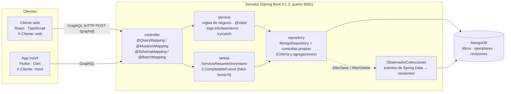
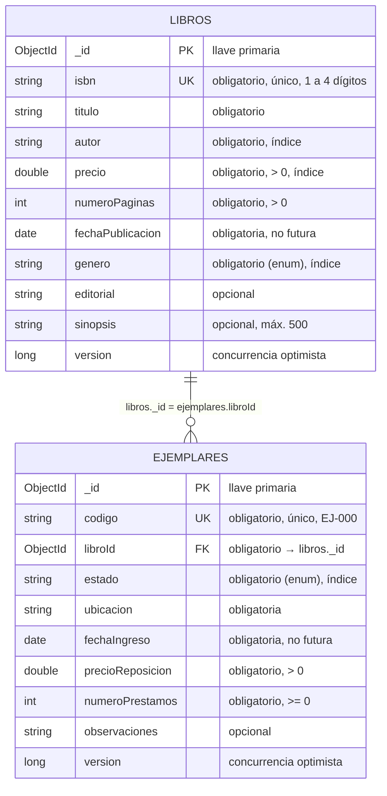
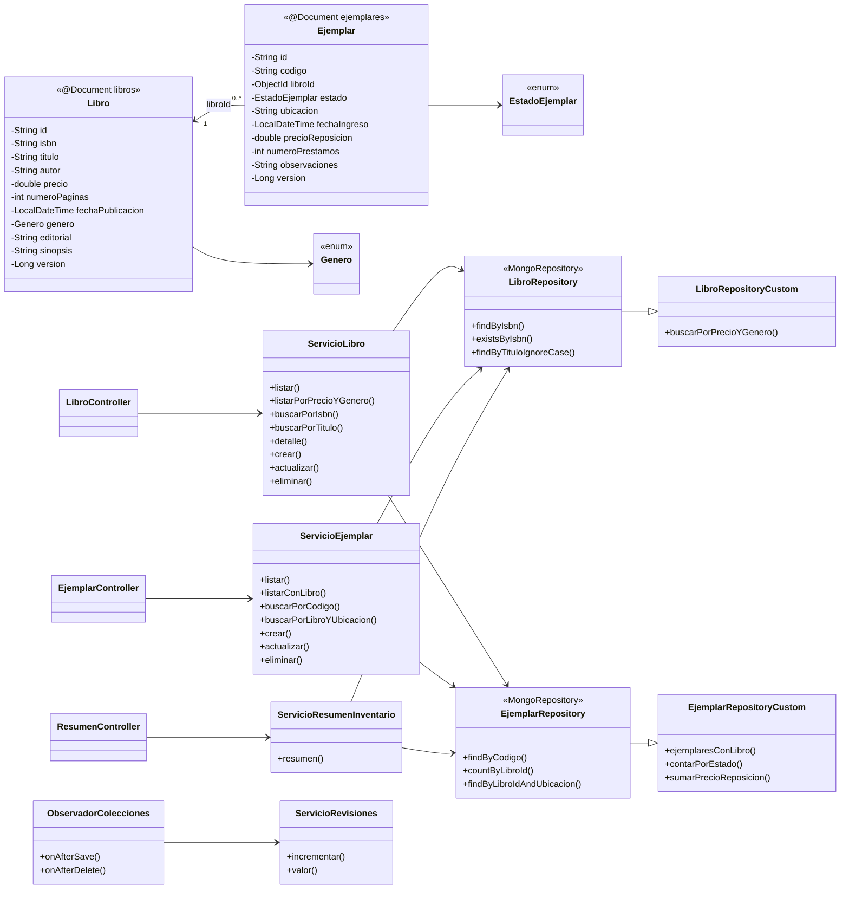

# Librería — Tercer Prototipo (MongoDB)

**Desarrollo de Aplicaciones Empresariales · Universidad de Ibagué · 2026B** · Profesor: Carlos Lugo
**Integrantes:** Misael Gallo Tangarife, Sara Zambrano, Santiago Guimel, Alejandra González · **Versión 3.0.0**

Continuación del Segundo Proyecto (mismo caso **Libro → Ejemplar** y los mismos clientes React y
Flutter). Lo nuevo: los datos ya no están en listas en memoria, sino en **MongoDB**, a través del
framework **Spring Data MongoDB**, en **dos colecciones** (`libros` y `ejemplares`).

| Proyecto | Tecnología | Carpeta |
|---|---|---|
| Servidor GraphQL | Java 17 · Spring Boot 4.1.2 · Spring for GraphQL · Spring Data MongoDB · Lombok · Bean Validation | [`servidor-libreria-mongo/`](servidor-libreria-mongo) |
| Cliente web | TypeScript · React 18 · Vite | [`cliente-web-react/`](cliente-web-react) |
| App móvil | Dart · Flutter (Android) | [`cliente-movil-flutter/`](cliente-movil-flutter) |
| Base de datos | MongoDB 8 (no relacional) | `localhost:27017`, base `libreria_evaluacion` |

---

## Arquitectura



- **GUI** (dos clientes en lenguaje distinto al servidor): una pantalla por caso de uso y menú
  principal con **Ayuda → Acerca de...** (integrantes y versión 3.0.0).
- **Modelo y clases estructurales en sus paquetes** (servidor `com.libreria.servidor`):

  | Paquete | Contenido |
  |---|---|
  | `model` | Documentos `Libro` y `Ejemplar` (`@Document`, `@Id`, `@Indexed`, `@Version`, Lombok `@Builder`), enums y tipos de respuesta (`Pagina`, `EjemplarConLibro`, `DetalleLibro`, `ResumenInventario`…) |
  | `dto` | `LibroInput`, `EjemplarInput` (un solo input para crear y actualizar) y la validación propia `@IsbnValido` |
  | `repository` | `LibroRepository`, `EjemplarRepository` (`MongoRepository`) y sus implementaciones de consultas propias |
  | `servicio` | `ServicioLibro`, `ServicioEjemplar`, `ServicioRevisiones`, `ObservadorColecciones`, `GeneradorDatosCarga` |
  | `controller` | `LibroController`, `EjemplarController`, `ResumenController` (GraphQL) |
  | `config` | `MongoConfig` (`AbstractMongoClientConfiguration`), `EjecutorTareasConfig`, escalar `LocalDateTime`, `RegistroOperaciones` (X-Cliente), `DatosIniciales` |
  | `excepciones` | `LibreriaException` (con tipo) y `ManejadorErrores` (errores GraphQL en español) |
  | `tareas` | `ServicioResumenInventario` (3 tareas concurrentes) |

## Modelo no relacional (MongoDB)



| Colección | Índices |
|---|---|
| `libros` | `_id`, **`isbn` (único)**, `autor`, `precio`, `genero`, compuesto `genero_precio` (genero, precio) |
| `ejemplares` | `_id`, **`codigo` (único)**, `libroId`, `estado`, compuesto `libro_ubicacion` (libroId, ubicacion) |
| `revisiones` | `_id` = nombre de la colección; `valor` aumenta con `$inc` en cada cambio (Observer entre clientes) |

Ejemplo real de un documento de `ejemplares` (la llave foránea es un `ObjectId`, no texto):

```json
{ "_id": {"$oid": "6af377e075da53cd0c59caab"}, "codigo": "EJ-001",
  "libroId": {"$oid": "6af377e075da53cd0c59ca9f"}, "estado": "PRESTADO", "ubicacion": "Estante A1",
  "fechaIngreso": {"$date": "2024-02-10T14:00:00Z"}, "precioReposicion": 65000.0,
  "numeroPrestamos": 5, "version": 1 }
```

Los clientes nunca manejan el `ObjectId`: envían y reciben el **ISBN** del libro y el servidor lo
traduce a `libroId` (`Ejemplar.libro` e `Ejemplar.isbnLibro` se resuelven con `@BatchMapping`, en una
sola consulta por respuesta).

## Diagrama de clases (servidor)



## Operaciones GraphQL

| Tipo | Operación | Para qué |
|---|---|---|
| Query | `libros(pagina, tamanio)` | Listar todos (paginado) |
| Query | `librosPorPrecioYGenero(precioMin, precioMax, genero, pagina, tamanio)` | **Consulta propia**: listar por filtro (Criteria en MongoDB) |
| Query | `libroPorIsbn(isbn)` · `libroPorTitulo(titulo)` | Consultar UN libro (dos criterios; el título sin mayúsculas ni tildes, con *collation*) |
| Query | `detalleLibro(isbn)` | **Consulta propia maestro + detalle**: libro, sus ejemplares y conteos por estado |
| Query | `ejemplares(pagina, tamanio)` | Listar todos los ejemplares (paginado) |
| Query | `ejemplaresConLibro(estado, isbn, pagina, tamanio)` | **Consulta propia** (`$lookup`): todos los atributos del ejemplar + isbn, título y autor del libro |
| Query | `ejemplarPorCodigo(codigo)` · `ejemplaresPorLibroYUbicacion(isbn, ubicacion)` | Consultar ejemplar (dos criterios) |
| Query | `revisionLibros` · `revisionEjemplares` | Observer entre clientes (contador en la colección `revisiones`) |
| Query | `resumenInventario` | Resumen calculado por las 3 tareas concurrentes |
| Mutation | `crearLibro` · `actualizarLibro(input: LibroInput)` · `eliminarLibro(isbn)` | CRUD de Libro (un solo input; el isbn indica cuál se actualiza) |
| Mutation | `crearEjemplar` · `actualizarEjemplar(input: EjemplarInput)` · `eliminarEjemplar(codigo)` | CRUD de Ejemplar (un solo input; el código indica cuál se actualiza) |
| Mutation | `generarDatosCarga(libros, ejemplares)` | Solo desarrollo (perfil `carga`): 1.000 libros y 5.000 ejemplares |

La consola GraphiQL queda en <http://localhost:8081/graphiql>.

## Reglas de negocio (en el servidor, nunca en la GUI)

- ISBN y código únicos (índices únicos de MongoDB).
- No se elimina un libro que tiene ejemplares.
- Un ejemplar solo se crea para un libro existente y no cambia de libro.
- `numeroPrestamos` suma 1 cuando el ejemplar **pasa** a PRESTADO; en Actualizar el valor que envía el cliente se ignora.
- Validaciones con Bean Validation (`@Valid`) y mensajes en español: obligatorios, positivos (`@Positive`, `@PositiveOrZero`), fechas no futuras (`@PastOrPresent`), ISBN de 1 a 4 dígitos (`@IsbnValido`) y código EJ-000 (`@Pattern`), largos máximos de los opcionales.

## Concurrencia y cantidad de datos

- **Altas simultáneas** del mismo ISBN/código: el índice único deja guardar solo una; la
  `DuplicateKeyException` se registra con `logger.warn` y responde "Ya existe…".
- **`@Version`** (concurrencia optimista): el cliente envía la versión que leyó; si otro usuario
  cambió el documento, MongoDB no lo guarda (`OptimisticLockingFailureException`) → `logger.warn` y
  "Otro usuario modificó este libro; vuelva a buscarlo".
- **Observer entre clientes**: `ObservadorColecciones` escucha los eventos de Spring Data
  (`AfterSaveEvent`, `AfterDeleteEvent`) y aumenta con `$inc` la revisión de la colección en MongoDB;
  los clientes la consultan cada 15 s y refrescan su grilla.
- **Servicio con 3 tareas** (`tareas/ServicioResumenInventario`): contar libros, contar ejemplares
  por estado (agregación) y valor total del inventario, en paralelo con `CompletableFuture` sobre el
  ejecutor propio `ejecutorTareas` (hilos `tarea-1..3`), unidas con `allOf`, con tiempo máximo
  (`orTimeout`) y `exceptionally` + `logger.error` si una falla (las otras dos igual se entregan).
- **Paginación en todos los Listar** (skip/limit en MongoDB) y filtros siempre en MongoDB. El
  `$lookup` se hace después de paginar: solo une los ejemplares de la página pedida.
- **Datos de entrega**: base `libreria_evaluacion` inicialmente vacía. El profesor crea los libros y
  ejemplares desde los clientes y se conservan entre reinicios. Los datos anteriores siguen en
  `libreria`. La carga de ejemplos requiere `libreria.datos-iniciales.habilitado=true`; el perfil
  `carga` usa su propia base `libreria_carga` con 1.000 libros y 5.000 ejemplares.

## Logging

`logback-spring.xml`: consola con hora, nivel, hilo y clase + archivo rotativo `logs/servidor.log`.
Cada servicio y controller tiene su `Logger` (SLF4J): **info** = operación recibida y resultado;
**warn** = rechazo de negocio (no existe, duplicado, validación, conflicto de versión); **error** =
excepción inesperada en el `catch` (con la excepción). Además `RegistroOperaciones` escribe una
línea por operación con el cliente que la hizo (encabezado `X-Cliente`). Ejemplos reales:

```
15:00:32.883 INFO  [tarea-2] c.l.s.t.ServicioResumenInventario - Tarea contar-ejemplares-por-estado iniciada en el hilo tarea-2
15:00:44.935 WARN  [http-nio-8081-exec-5] c.l.servidor.servicio.ServicioLibro - Crear libro rechazado: Ya existe un libro con el ISBN 1001.
15:06:23.820 ERROR [tarea-2] c.l.s.t.ServicioResumenInventario - Tarea contar-libros falló: DataAccessResourceFailureException: MongoDB no responde
15:00:44  App móvil    | consulta ejemplaresConLibro
```

## Cómo correr todo

**Requisitos:** MongoDB 8 en `localhost:27017`, JDK 17 (`JAVA_HOME`), Node 22, Flutter 3.41 y,
para el celular, Android platform-tools (`adb`).

**Todo de una vez (Windows):** doble clic en `iniciar-demo.cmd`. Comprueba que MongoDB esté arriba
(si no, lo inicia: primero el servicio de Windows y, si pide administrador, como proceso del
usuario), levanta el servidor, el cliente web y, si hay un celular conectado por USB, instala y
abre la app (`adb reverse tcp:8081 tcp:8081`).

**Por partes:**

```bash
# 1. Servidor (base de evaluacion vacia, sin registros de ejemplo)
cd servidor-libreria-mongo
./mvnw spring-boot:run                                   # http://localhost:8081/graphql
./mvnw spring-boot:run -Dspring-boot.run.profiles=carga  # base libreria_carga con 1.000 + 5.000

# 2. Cliente web
cd cliente-web-react && npm install && npm run dev      # http://localhost:5173

# 3. App (celular por USB)
adb reverse tcp:8081 tcp:8081
cd cliente-movil-flutter && flutter run --dart-define=URL_GRAPHQL=http://localhost:8081/graphql
```

La URL y la base de MongoDB se cambian con `LIBRERIA_MONGO_URI` y `LIBRERIA_MONGO_BASE`.

**Verificar las colecciones en MongoDB:** `scripts\verificar-mongo.cmd` (usa el driver de MongoDB
que descarga Maven) o, con `mongosh`:

```js
use libreria_evaluacion
show collections                                  // libros, ejemplares, revisiones
db.ejemplares.getIndexes()
db.ejemplares.findOne({ codigo: "EJ-001" })       // libroId: ObjectId("…")
db.ejemplares.aggregate([{ $lookup: { from: "libros", localField: "libroId", foreignField: "_id", as: "libro" } },
                         { $match: { libro: { $size: 0 } } }, { $count: "huerfanos" }])   // sin resultados
```

## Pruebas

| Proyecto | Comando | Resultado |
|---|---|---|
| Servidor | `./mvnw verify` (base `libreria_test`, se limpia antes de cada prueba) | **74 pruebas**: servicios, reglas, validaciones, consultas propias, GraphQL completo, HTTP/CORS/X-Cliente, estructura de MongoDB, concurrencia, 3 tareas y carga |
| Web | `npm run lint`, `npm test`, `npm run build` | **84 pruebas** unitarias (Vitest) |
| Web E2E | `npm run e2e` (Playwright contra el servidor real con MongoDB) | **32 pruebas**: todos los casos de uso de ambos objetos en escritorio y celular, con capturas |
| App | `flutter analyze`, `flutter test` | **46 pruebas** + integración contra el servidor real |

**Concurrencia:** 20 altas simultáneas del mismo ISBN → exactamente 1 éxito y 19 "Ya existe";
2 actualizaciones con la misma versión → 1 éxito y 1 conflicto; 2 préstamos simultáneos del mismo
ejemplar → 1 conflicto y el contador queda bien (+1).

**Carga** (1.000 libros y 5.000 ejemplares, promedio de 5 ejecuciones, `CargaTest`):

| Consulta | ms |
|---|---|
| Generar 1.000 libros + 5.000 ejemplares (insertMany) | 415 |
| Listar libros, página 1 de 50 (20 por página) | 7 |
| Listar libros, página 50 de 50 | 7 |
| Libros por precio 50.000–100.000 y FICCION | 6 |
| `ejemplaresConLibro` página 1 | 6 |
| `ejemplaresConLibro` página 250 de 250 | 9 |
| `ejemplaresConLibro` filtro PRESTADO | 6 |
| `resumenInventario` (3 tareas) | 6 |

## Cómo se cumple la rúbrica

| Punto | Dónde |
|---|---|
| Arquitectura con GUI, modelo y clases estructurales en paquetes | Tabla de paquetes de arriba; clientes en `paginas/` (web) y `pantallas/` (app) |
| GraphQL | `schema.graphqls` + controllers con `@QueryMapping` / `@MutationMapping` / `@SchemaMapping` / `@BatchMapping` |
| Dos clientes en lenguaje distinto (web y app) | React/TypeScript y Flutter/Dart |
| Base no relacional con framework, dos colecciones | MongoDB + Spring Data MongoDB: `libros` y `ejemplares` (`@Document`, `MongoRepository`) |
| Prohibido guardar en listas | No hay repositorios en memoria: todo pasa por `MongoRepository` / `MongoTemplate` |
| Insertar 15 % | Adicionar Libro / Adicionar Ejemplar (validación en cliente y servidor) |
| Eliminar 20 % (buscar antes y mostrar TODO) | Eliminar: ficha con todos los atributos, incluidos opcionales, `_id`, `libroId` y versión; confirmación |
| Actualizar 20 % (buscar antes y mostrar TODO) | Actualizar: ficha completa + formulario; versión para la concurrencia |
| Consultar UN objeto por un parámetro 20 % | Libro por ISBN o título; Ejemplar por código o ISBN + ubicación |
| Listar 25 %: grilla, filtro, dos consultas propias, Ejemplar con 2 atributos de Libro | `libros` / `librosPorPrecioYGenero` y `ejemplares` / `ejemplaresConLibro` (todos los atributos + título y autor), paginados |
| Llave primaria, obligatorios y opcionales, validaciones, ≥ 5 atributos (int, double, String, LocalDateTime, otro) | Ver el modelo: `_id`, `numeroPaginas`/`numeroPrestamos` (int), `precio` (double), `titulo` (String), fechas (LocalDateTime), `genero`/`estado` (enum), opcionales editorial, sinopsis y observaciones |
| Dos consultas propias, una con maestro y detalle | `librosPorPrecioYGenero` (Criteria), `ejemplaresConLibro` (`$lookup`) y `detalleLibro` (maestro + detalle) |
| Búsqueda individual con dos criterios por objeto | Ver Consultar |
| Excepciones con mensajes coherentes | `LibreriaException` + `ManejadorErrores` (código en `extensions.codigo`) |
| Una ventana por caso de uso; menú con Ayuda → Acerca de | Rutas de la web y de la app; Acerca de con los 4 integrantes y versión 3.0.0 |
| `@Id` y `ObjectId` como llave foránea | `Libro.id`, `Ejemplar.id` con `@Id`; `Ejemplar.libroId` es `ObjectId` |
| Logging en 3 niveles y try/catch | Servicios y controllers; `logback-spring.xml` |
| Servicio con 3 tareas concurrentes | `tareas/ServicioResumenInventario` |
| Concurrencia y cantidad de datos | Índices únicos, `@Version`, paginación, perfil `carga`, `ConcurrenciaTest` y `CargaTest` |
| Subir a GitHub | Este repositorio, con integración continua (GitHub Actions) |

## Patrones de diseño

| Patrón | Dónde |
|---|---|
| MVC | Servidor: `model` / `servicio` / `controller`; clientes: modelos, servicios GraphQL, pantallas |
| Builder | `Libro.builder()` y `Ejemplar.builder()` (Lombok `@Builder`), usados en los servicios, la semilla y el generador |
| Observer | Servidor: `ObservadorColecciones` (eventos de Spring Data) → revisiones; web: `observer/Observable.ts`; app: `observador/listado_observable.dart` |
| Singleton | `ClienteGraphQL` en la web (`getInstancia()`) y en la app (constructor de fábrica) |
